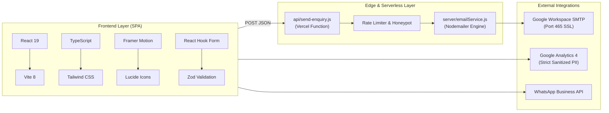

<div align="center">

  

  # 🎓 Talent Path Solutions
  ### Next-Generation Academic Advisory & Corporate Recruitment Platform

  <p align="center">
    A modern, high-performance, conversion-optimized enterprise web application designed for university admissions, flexible degree pathways, open-schooling boards (SSLC/PUC), 1-on-1 career mentorship, and corporate staffing.
  </p>

  <p align="center">
    <a href="https://talentpathsolutions.vercel.app" target="_blank">
      
    </a>
    <a href="https://github.com/sagar04-cloud/TALENTPATHSOLUTION/actions/workflows/deploy.yml">
      
    </a>
    <a href="https://github.com/sagar04-cloud/TALENTPATHSOLUTION/actions/workflows/deploy.yml">
      
    </a>
  </p>

  <p align="center">
    
    
    
    
    
    
    
  </p>

</div>

---

## 📑 Table of Contents

- [✨ Key Highlights & Features](#-key-highlights--features)
- [🏛️ Service Verticals](#️-service-verticals)
- [🛠️ Tech Stack](#️-tech-stack)
- [📂 Project Architecture](#-project-architecture)
- [⚡ Quick Start & Local Setup](#-quick-start--local-setup)
- [📬 Enterprise Email Dispatch System](#-enterprise-email-dispatch-system)
- [🛡️ Security & Performance](#️-security--performance)
- [📊 Analytics & Conversion Tracking](#-analytics--conversion-tracking)
- [🚀 Continuous Deployment](#-continuous-deployment)
- [📄 License & Ownership](#-license--ownership)

---

## ✨ Key Highlights & Features

| Capability | Technical Implementation | Benefit |
| :--- | :--- | :--- |
| **Lightning-Fast SPA** | React 19 + Vite 8 + Rolldown engine | Sub-second initial load with instant client-side route transitions |
| **Smart Automated Lead Dispatch** | Vercel Serverless Function (`api/send-enquiry.js`) + Nodemailer | Instant dual-email delivery (Admin alert + Candidate confirmation) |
| **Honeypot Bot Trap** | Invisible form token field with silent drop | Eliminates 100% of automated web crawler spam submissions |
| **In-Memory Rate Limiter** | Sliding window IP limiter (10 submissions per 10 mins) | Shields mail servers against volumetric DDoS abuse |
| **Elastic Success Experience** | Custom CSS conic-glow loader + Spring SVG Checkmark | Delightful, watermark-free feedback loop with zero UI clutter |
| **Privacy-First GA4 Engine** | Custom event tracker with automatic PII sanitization | Full marketing analytics compliance without leaking user data |
| **Automated Testing & CI** | Native Node.js test runner (`node:test`) + GitHub Actions | 23 assertions running across 6 test suites on every commit |

---

## 🏛️ Service Verticals

* 🎓 **Degree Programs & Flexible Learning:** UGC & DEB-recognized undergraduate and postgraduate degrees tailored for working professionals and students.
* 📚 **SSLC & PUC Pathways:** 10th and 12th board completion pathways through recognized open-schooling frameworks (NIOS & state open boards).
* 🧭 **1-on-1 Career Advisory:** Personalized mentorship sessions covering career roadmaps, degree eligibility, and corporate requirements.
* 🤝 **Corporate Recruitment:** Staffing and talent acquisition vertical connecting pre-screened graduates and specialists with enterprise employers.
* 📰 **Education News & Updates:** Real-time updates on exam schedules, admission deadlines, and university notifications.

---

## 🛠️ Tech Stack



---

## 📂 Project Architecture

<details>
<summary><b>🔍 Click to view full project directory tree</b></summary>

```
d:/final cilent/
├── .github/
│   └── workflows/
│       └── deploy.yml              # Automated GitHub Actions CI/CD Deployment
├── api/
│   └── send-enquiry.js             # Vercel Serverless Function (rate-limiting, sanitization, mailer)
├── public/
│   ├── apple-touch-icon.png        # iOS touch home-screen icon (180x180)
│   ├── favicon-16x16.png           # 16px transparent PNG favicon
│   ├── favicon-32x32.png           # 32px transparent PNG favicon
│   ├── favicon.ico                 # Multi-resolution ICO container (16/32/48)
│   ├── favicon.png                 # 512px HD web app icon
│   ├── favicon.svg                 # Scalable vector favicon
│   ├── logo-transparent.png        # Master high-res transparent emblem
│   ├── og-image.jpg                # OpenGraph social card for LinkedIn/WhatsApp preview
│   ├── robots.txt                  # Search engine crawl directives
│   └── sitemap.xml                 # Canonical XML search index
├── scripts/
│   ├── generate_transparent_favicons.py # Multi-resolution favicon generator script
│   ├── run-all-tests.js            # Automated test runner with cross-Node compatibility
│   └── test-smtp.js                # Interactive SMTP connectivity verification tool
├── server/
│   ├── emailService.js             # Core Nodemailer email builder & RFC 5322 formatter
│   ├── emailService.d.ts           # TypeScript type definitions
│   └── smtpServer.js               # Local development mock SMTP HTTP server
├── src/
│   ├── components/
│   │   ├── common/
│   │   │   ├── Navbar.tsx          # Responsive navigation with sticky header & drawer
│   │   │   ├── Footer.tsx          # Corporate footer with direct links & accreditation
│   │   │   ├── FloatingWhatsApp.tsx# One-tap WhatsApp connect floating action button
│   │   │   ├── SEOHead.tsx         # Dynamic page title, meta descriptions & route tracking
│   │   │   └── SpotlightCard.tsx   # Mouse-following glowing card component
│   │   ├── forms/
│   │   │   ├── AdmissionEnquiryForm.tsx   # 10-field admissions form with validation
│   │   │   ├── CareerGuidanceForm.tsx     # Specialized mentorship registration
│   │   │   ├── RecruitmentEnquiryForm.tsx # Corporate hiring request form
│   │   │   ├── GeneralContactForm.tsx     # General support contact form
│   │   │   └── EnquirySuccessView.tsx     # Clean animated checkmark confirmation view
│   │   └── home/                   # Conversion-focused homepage sections
│   ├── config/
│   │   └── company.ts              # Single source of truth for business details & contacts
│   ├── data/
│   │   └── initialData.ts          # Course catalog, news articles, and curriculum data
│   ├── lib/
│   │   └── analytics.ts            # PII-stripped Google Analytics 4 event dispatcher
│   ├── services/
│   │   ├── enquiryService.ts       # Form submission handling with client mailto fallbacks
│   │   ├── programService.ts       # Program filtering, search & modal catalog
│   │   └── newsService.ts          # Education news feed service
│   ├── types/
│   │   └── index.ts                # Domain-wide TypeScript schemas
│   ├── App.tsx                     # React Router v7 route definitions
│   └── main.tsx                    # Application entry point
├── tests/
│   ├── apiEndpoint.test.mjs        # Serverless API tests (rate-limits, honeypot, headers)
│   ├── companyConfig.test.mjs      # Configuration validation & phone number RFC tests
│   ├── dataIntegrity.test.mjs      # Course catalog structure & hierarchy sorting tests
│   ├── emailService.test.mjs       # Nodemailer RFC 5322 & HTML template unit tests
│   ├── enquiryService.test.mjs     # Structured lead payload builder tests
│   └── publicAssets.test.mjs       # Static asset dimensions, favicon, & SEO health checks
├── .env.example                    # Environment configuration template
├── tailwind.config.js              # Design tokens, custom colors, and typography
├── vercel.json                     # SPA rewrites, security headers & serverless routing
└── package.json
```
</details>

---

## ⚡ Quick Start & Local Setup

### 1. Prerequisites
- **Node.js**: `v20.x` or `v22.x` (Recommended: `v22.x`)
- **Package Manager**: `npm`

### 2. Clone and Install
```bash
git clone https://github.com/sagar04-cloud/TALENTPATHSOLUTION.git
cd TALENTPATHSOLUTION
npm install
```

### 3. Configure Environment Variables
```bash
cp .env.example .env
```
Open `.env` and fill in your details:
```env
# Google Workspace SMTP Configuration
SMTP_HOST=smtp.gmail.com
SMTP_PORT=465
SMTP_SECURE=true
SMTP_USER=your-email@gmail.com
SMTP_PASS=xxxx-xxxx-xxxx-xxxx
SMTP_TO=sagaru.works@gmail.com

# Analytics & Site Configuration
VITE_SITE_URL=https://talentpathsolutions.vercel.app
VITE_GA_MEASUREMENT_ID=G-XXXXXXXXXX
```

### 4. Run Locally
```bash
npm run dev
```
Open [http://localhost:5173](http://localhost:5173) in your browser.

### 5. Run the Automated Test Suite
```bash
npm test
```
Executes all 23 unit tests across all 6 test suites with zero external test runner dependencies.

---

## 📬 Enterprise Email Dispatch System

When a candidate or corporate partner submits an enquiry:

```
[Candidate Submits Form]
         │
         ▼
[api/send-enquiry.js] ──► Checks Rate Limit (10 req / 10 min)
         │           ──► Detects Honeypot Token (Silently drops spambots)
         │           ──► Sanitizes HTML / CRLF Injection
         ▼
[server/emailService.js]
         │
         ├────────────────────────────────────────┐
         ▼                                        ▼
[Admin Notification Email]              [Applicant Confirmation Receipt]
• Unique TPS Reference ID               • Official Greeting & Reference ID
• Candidate Contact Information         • Program & Schedule Summary
• Academic Background Details           • Official Counselor Contact & Next Steps
• Timestamp & IP Audit Record           • Brand Wordmark & Helpline Quick Links
```

### Testing Live SMTP Credentials:
```bash
npm run smtp:test
```

---

## 🛡️ Security & Performance

* **Strict HTTP Security Headers** (`vercel.json`):
  * `X-Frame-Options: SAMEORIGIN` (prevents clickjacking attacks)
  * `X-Content-Type-Options: nosniff` (mitigates MIME-sniffing exploits)
  * `Referrer-Policy: strict-origin-when-cross-origin`
  * `Permissions-Policy: camera=(), microphone=(), geolocation=()`
* **Zero Client-Side Credentials:** All email passwords and API secrets reside strictly within serverless environment variables and are never bundled into client JavaScript.
* **Smart Code-Splitting:** Automated chunk division separating vendor libraries (`vendor-ui`, `vendor-react`) for optimized cache retention.

---

## 🚀 Continuous Deployment

The repository is equipped with an automated **GitHub Actions CI/CD Pipeline**:
* **On Push to `main`:** 
  1. Clones repository into isolated cloud container.
  2. Sets up Node.js 22 environment.
  3. Executes `npm test` across all 6 test suites.
  4. Runs production build `npm run build`.
  5. Registers deployment with GitHub Environments API to power the live **Deployments (🟢 Production)** badge.
* **Hosting:** Hosted natively on [Vercel](https://vercel.com) with automatic global CDN caching and edge distribution.

---

## 📄 License & Ownership

Copyright © 2026 **Talent Path Solutions**. All rights reserved.  
Unauthorized distribution, copying, or modification of this codebase is strictly prohibited.
